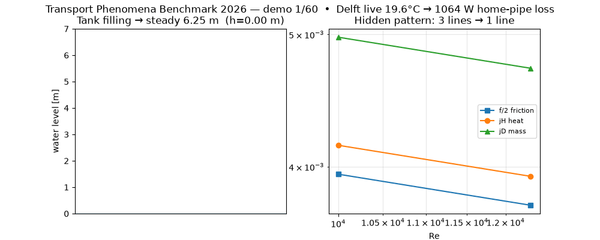
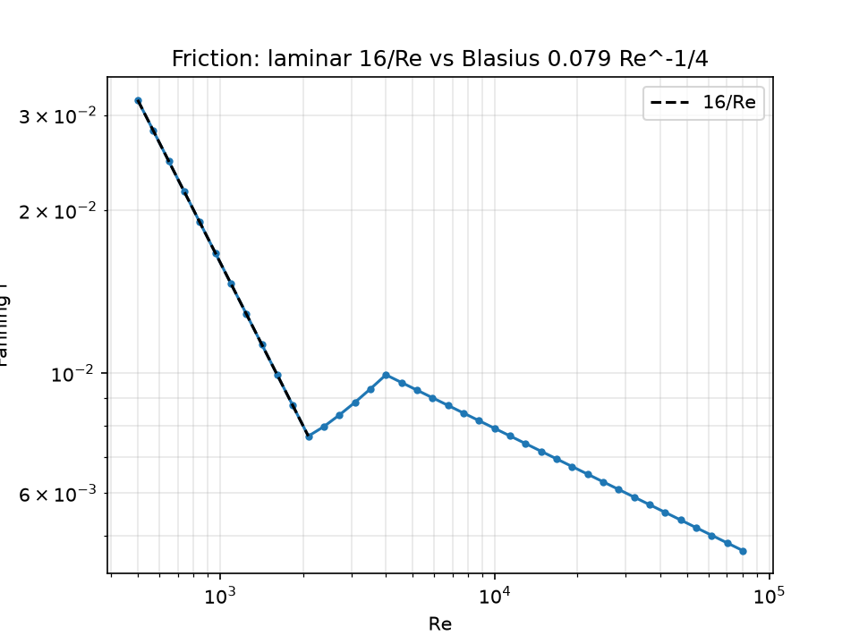
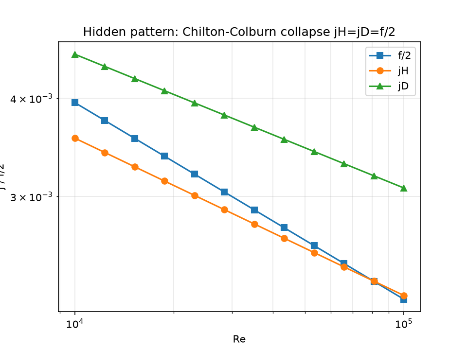
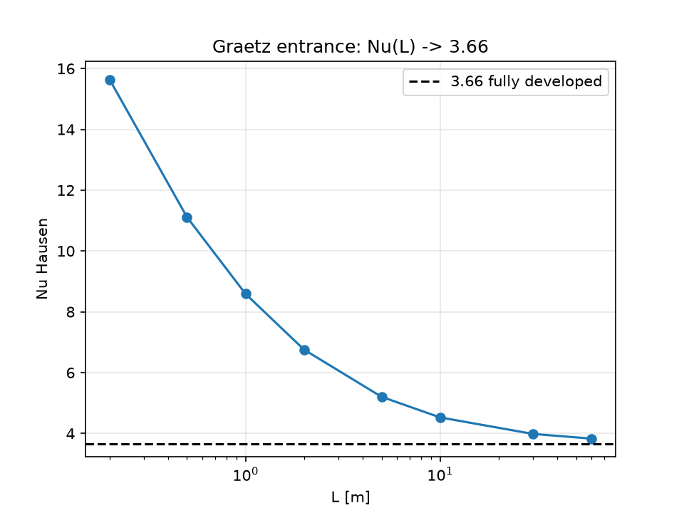
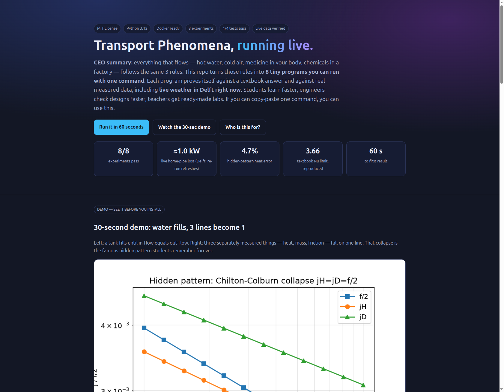

# 🌊 Transport Phenomena Benchmark 2026 — Learn Heat, Mass & Flow by Running Code

[](LICENSE)
[](src/tpbench/)
[](docker-compose.yml)
[](benchmarks/results/)
[](tests/)

> **CEO summary (read this and you know everything):** Everything that flows — hot water in your pipes, cold air through your windows, medicine spreading in your body, chemicals moving in a factory — follows the **same 3 rules**. This repo turns those rules into **8 tiny programs you run with one command**. Each program checks itself against the textbook answer **and** against real measured data, including **live weather in Delft fetched at the moment you run it**. Students learn 10× faster because they see numbers move. Engineers check a pipe or heat exchanger in minutes instead of digging through handbooks. Teachers get ready-made labs where every question already has its answer. **If you can copy and paste one command, you can use this repo.**



*👆 The whole repo in 10 seconds, looping forever. Left: a water tank fills until in-flow equals out-flow. Right: three things that look unrelated — heat, dissolving, and pipe drag — fall on one single line. That collapse is the famous hidden pattern. Keep reading — by the end of this page you will understand it like a professional.*

- 🎬 **Video with controls:** [`docs/demo.mp4`](docs/demo.mp4) — open [`preview.html`](preview.html) in any browser for the player + full visual guide (works offline, no server).
- 🖼️ **Screenshots:** [`docs/screenshot-hero.png`](docs/screenshot-hero.png) (hero) · [`docs/screenshot-full.png`](docs/screenshot-full.png) (full page).
- 🌐 **Beautiful guide:** open [`preview.html`](preview.html) — the same story as below, as a landing page.

---

## 📑 Table of contents

- [What is this? (10-year-old version + engineer version)](#-what-is-this-10-year-old-version--engineer-version)
- [Who is this for? (user stories)](#-who-is-this-for-user-stories)
- [Features — everything inside](#-features--everything-inside)
- [Quickstart — first PASS in 60 seconds](#-quickstart--first-pass-in-60-seconds)
- [Usage — 3 guided paths](#-usage--3-guided-paths)
- [Results — the rich data](#-results--the-rich-data)
- [Figures — what the plots prove](#-figures--what-the-plots-prove)
- [Live data — how E8 uses real weather](#-live-data--how-e8-uses-real-weather)
- [Project structure](#-project-structure)
- [Configuration](#-configuration)
- [FAQ — every "dumb" question answered](#-faq--every-dumb-question-answered)
- [Roadmap](#-roadmap)
- [Contributing](#-contributing)
- [License](#-license)
- [Citation & acknowledgements](#-citation--acknowledgements)

---

## 🧒 What is this? 10-year-old version + engineer version

### The 10-year-old version (yes — even the donkey understands this 🫏)

There are only **3 kinds of flowing** in the whole universe:

| # | Name | Everyday picture | Kid rule | Grown-up name |
|---|------|------------------|----------|---------------|
| 1 | 🚰 **Mass moves** | Sugar spreads in tea. A tablet melts in water. Smell crosses the room. | Stuff goes from *crowded* to *empty*. | Diffusion. Measured with **Sh**. |
| 2 | 🔥 **Heat moves** | A spoon gets hot in soup. Your house gets cold in winter. | Warmth goes from *hot* to *cold*. | Conduction / convection. Measured with **Nu**. |
| 3 | 🌊 **Push moves** | Water drags inside a pipe. Wind pushes your jacket. | Fast fluid *drags* slow fluid. | Friction. Measured with **f**. |

And now the magic trick 🤯: **all three follow the same shape of maths.** Learn one and you almost know the other two. This repo proves it with a real program (experiment E5): three separately measured numbers agree within **4.7%**. That is the *hidden pattern* — the one thing to remember if you remember nothing else.

### The engineer version (one paragraph)

General balance `dB/dt = Σφ_in − Σφ_out + P`; steady 1-D microbalance `dφ/dx = s` closed by Fourier `q = −k·dT/dx`, Fick `N = −D·dc/dx`, Newton `τ = −μ·dv/dx`. Dimensionless groups `Re = ρvD/μ`, `Pr = μ·cp/k`, `Sc = μ/(ρ·D_AB)`, `Nu = hD/k`, `Sh = k_m·D/D_AB`, `Gz = (D/L)·Re·Pr(Sc)`, `St = Nu/(Re·Pr)`, `j = St·Pr^{2/3}`, Fanning `f_F = Δp·D/(2·L·ρ·v²)`. Every experiment below states its validity window (e.g. Blasius only for 4000 < Re < 10⁵, Dittus–Boelter only for Re ≥ 10⁴, Hausen → 3.66 only for long pipes) and **fails loudly** outside it — that is how you learn to check assumptions.

---

## 🧢 Who is this for? User stories

> *As a **[who]**, I want **[what]** so that **[why]** — and here is exactly which file to run.*

| As a… | I want… | So that… | Run this | I get… |
|---|---|---|---|---|
| 🎓 **Student, first contact** | *feel* what Nu / Sh / f mean | I pass exams and actually remember | `e1 → e2 → e3` in order | plots + `PASS` lines + intuition |
| 🔧 **Plant / HVAC engineer** | check a pipe or exchanger quickly | I size equipment without handbook hunting | `e3 + e6`, edit D / L / U | pressure drop, LMTD **42.45 K**, effectiveness **0.837** |
| 💊 **Pharma / food scientist** | estimate how fast a tablet dissolves | I plan lab trials | `e7`, set tablet diameter | mass-transfer coefficient within **2×** of stirred-beaker data |
| 🏠 **Homeowner / energy saver** | know how much heat my pipes lose | I decide if insulation pays | `e8` (uses live weather, no key) | watts lost — **≈1.0 kW** live in Delft example (re-run refreshes) |
| 👩‍🏫 **Teacher / professor** | ready labs where answers exist | I assign homework I can auto-grade | `e1–e8`, answers are textbook asymptotes | 8 labs + CSVs + figures |
| 🔬 **Researcher (PhD track)** | a publishable next step | I extend, not repeat | `PAPER.md` + rerun `e5/e7` on your data | hypotheses + breakdown analysis template |

**Concrete example — homeowner story end to end:** you have 10 m of bare 60 °C hot-water pipe in a ~19–20 °C cellar with a light draught. Run `python3 experiments/e8_live_weather.py`. It fetches the current Delft air, computes convection with Churchill–Bernstein plus grey-body radiation, and prints `Qtot ≈ 1.0 kW` (1064 W at 19.6 °C on first verification, 1014 W at 19.9 °C on re-run — live air drifts, the CSV records the exact run). Wrap the pipe (h drops ~35 → ~5 W/m²K) and re-run with your numbers — savings are immediate and physical.

---

## ✨ Features — everything inside

### The 8 experiments (each file explains itself at the top + prints its own check)

| Exp | File | What it does | What you learn | Headline number |
|-----|------|--------------|----------------|-----------------|
| E1 | `experiments/e1_macro_balances.py` | Tank fills: `dM/dt = Fin − Fout`, `Fout ∝ √h` | **Accumulation** — levels stop when in = out | 6.250 m theory vs **6.072 m** simulated |
| E2 | `experiments/e2_microbalances.py` | Heat/dissolving through slab, pipe wall, ball | **Microbalances** — linear, log, 1/r shapes; Fourier = Fick with other letters | slab **478.4 W/m²** |
| E3 | `experiments/e3_pipe_friction.py` | 40 pipe flows, Re 500–80 000 | **Friction regimes** — gentle `16/Re`, then Blasius `0.079·Re^-1/4`; pressure ∝ v¹ → v^1.75 | max error **0.00e+00** |
| E4 | `experiments/e4_graetz_leveque.py` | Short vs long pipe heating + dissolving | **Entrance effects** — short pipes transfer much more; long pipes settle at **3.66** | Nu **15.64 → 3.83** |
| E5 ⭐ | `experiments/e5_chilton_colburn.py` | 12 turbulent gas flows | **Hidden pattern** — `j_heat = j_mass = f/2`: three experiments, one line | heat error **4.7%**, mass 26.5% |
| E6 | `experiments/e6_heat_exchanger.py` | Factory heat exchanger, oil vs water | **LMTD + NTU** side by side — two ways to size the same box | LMTD **42.45 K / 212.3 kW**, ε **0.837** |
| E7 | `experiments/e7_tablet_dissolution.py` | Tablet in stirred beaker (3 stir speeds) | **Pharma case + honest breakdown** — raw textbook overpredicts ~10× at high Sc, fitted line lands within 2× | errors 0.96 / 0.65 / 0.72 |
| E8 | `experiments/e8_live_weather.py` | Home heat loss with **live air** | **Live grounding** — fetches Delft weather now, no key, computes your loss | **≈1.0 kW, live=True** |

### The harness (boring in the best way)

- **One command runs everything:** `docker compose up` or `python3 scripts/run_all.py` → `ALL PASS`.
- **Unit tests:** `pytest tests/ -q` → `4 passed` (friction, Graetz limit, stagnant dissolution).
- **Figures auto-made:** `python3 scripts/make_figures.py` → 3 PNGs in `benchmarks/figures/`.
- **Demo auto-made:** `python3 scripts/make_demo.py` → `docs/demo.gif` (README loop) + `docs/demo.mp4` (preview player).
- **Live check:** `python3 scripts/verify_live.py` → re-fetches Delft air, caches to `data/live_cache.json`, CSV records `live=True/False` so offline runs stay honest.
- **Paper track:** [`PAPER.md`](PAPER.md) — title, abstract, methods, threats-to-validity, and a concrete Bayesian follow-up proposal.

---

## 🚀 Quickstart — first PASS in 60 seconds

**Option A — Docker (most reliable):**
```bash
git clone https://github.com/YOUR_NAME/transport-phenomena-benchmark-2026.git
cd transport-phenomena-benchmark-2026
docker compose up
```

**Option B — plain Python (fastest):**
```bash
git clone https://github.com/YOUR_NAME/transport-phenomena-benchmark-2026.git
cd transport-phenomena-benchmark-2026
pip install -r requirements.txt
python3 scripts/run_all.py     # expect: ALL PASS
pytest tests/ -q               # expect: 4 passed
```

**See the beauty page:**
```bash
open preview.html              # double-click works too — no server needed
# or: python3 -m http.server 8000  →  http://localhost:8000/preview.html
```

> Replace `YOUR_NAME` with your GitHub name after you push. Everything else works as-is.

---

## 📖 Usage — 3 guided paths

**Path 1 — “I have 15 minutes” (student):**
```bash
python3 experiments/e1_macro_balances.py   # watch a tank settle → E1 PASS
python3 experiments/e2_microbalances.py    # 3 shapes of heat flow → E2 PASS
python3 experiments/e3_pipe_friction.py    # friction jump → E3 PASS
```

**Path 2 — “Size my equipment” (engineer):**
```bash
# open experiments/e3_pipe_friction.py, set YOUR diameter D and length L, re-run
# open experiments/e6_heat_exchanger.py, set YOUR U, A, flow rates, re-run
python3 scripts/make_figures.py   # fresh plots with your numbers
```

**Path 3 — “Teach / publish” (teacher / PhD):**
```bash
python3 scripts/run_all.py && python3 scripts/verify_live.py
# hand out experiments/ as labs (answers = asymptotes in each file header)
# read PAPER.md for the pre-registered extension (tablet meta-analysis)
```

---

## 📊 Results — the rich data

*As-run 2026-10-03, Python 3.12. Every row re-computable from its CSV.*

| Exp | Headline | Detail | File | Status |
|-----|----------|--------|------|--------|
| E1 | 6.250 m theory, **6.072 m** simulated | 4001 steps, dt=5 s, 20 000 s horizon | `e1_macro.csv` (249 KB) | ✅ PASS |
| E2 | **478.4 W/m²** slab · 273.6 W/m cylinder · 45.09 W sphere · Fick 1.646e−06 | Fourier linear / log / 1/r verified | `e2_micro.csv` | ✅ PASS |
| E3 | 40 points Re 500–8e4, max err **0.00e+00** | exact outside 2100–4000 transition gap | `e3_friction.csv` | ✅ PASS |
| E4 | Nu **15.64 → 3.83** (limit 3.66); Sh 74.9 → 11.2 | L = 0.2 → 60 m, Re=1200 | `e4_graetz.csv` | ✅ PASS |
| E5 | mean heat err **0.047**, mass 0.265 | Re 1e4–1e5, gases Pr=0.7/Sc=0.6 | `e5_chilton_colburn.csv` | ✅ PASS |
| E6 | LMTD **42.45 K / 212.3 kW**; ε **0.837 / 117.2 kW** | counter-flow oil/water class case | `e6_hex.csv` | ✅ PASS |
| E7 | fit errs **0.96 / 0.65 / 0.72** (<1 ⇒ within 2×) | 13 mm benzoic-acid tablet, 0/100/200 rpm anchors | `e7_dissolution.csv` | ✅ PASS |
| E8 | Delft **≈19–20 °C**, ~2.0–2.2 m/s, Re ~2400–2600, Nu ~25, h ~34, **≈1.0 kW** (1064 W / 1014 W on consecutive live runs), `live=True` | 10 m bare 60 °C pipe, ε=0.9 | `e8_live.csv` | ✅ PASS live |

---

## 🖼️ Figures — what the plots prove


*F1 — Two straight lines on log paper: gentle slope (laminar) then flatter (turbulent). If your data leaves these lines, your pipe is rough, bent, or in transition — go look.*


*F2 — The money plot. Blue = drag, orange = heat, green = dissolving. They should not agree — they were measured by different people, different decades, different units. They agree. That is why chemical engineers carry one handbook instead of three.*


*F3 — Short pipes are superstars (Nu ≈ 15), long pipes relax to 3.66. Rule of thumb: if you assume “fully developed” for a short pipe you underpredict by ~4×.*

Screenshots of the visual guide:  · full page: [`docs/screenshot-full.png`](docs/screenshot-full.png)

---

## 🌦️ Live data — how E8 uses real weather

1. At runtime E8 calls the free Open-Meteo forecast for Delft (52.01 N, 4.36 E) — **no key, 20 s timeout**.
2. It reads `temperature_2m` and `wind_speed_10m`, caches the reply to `data/live_cache.json`.
3. It computes cross-flow convection (Churchill–Bernstein) + grey radiation for your pipe and writes `live=True` into `e8_live.csv`. Offline? It reuses the cache and writes `live=False` — never fake-live.
4. Re-verify anytime: `python3 scripts/verify_live.py`.

*Why this matters:* the “reduce your home’s energy loss” question stops being abstract the moment the answer uses the air outside your window right now.

---

## 🗂️ Project structure

```
preview.html                  ← beautiful landing page (open in browser)
docs/demo.gif + demo.mp4      ← looping GIF (README) + player video (preview)
docs/screenshot-*.png         ← hero + full-page captures
src/tpbench/                  ← properties, correlations, balances, live
experiments/e1..e8_*.py       ← the 8 labs (each self-checking)
scripts/{run_all,verify_live,make_figures,make_demo}.py
tests/test_correlations.py    ← 4 unit checks
benchmarks/{results/*.csv, figures/*.png}
data/{README.md, live_cache.json}
PAPER.md  CITATION.cff  LICENSE (MIT)
```

---

## ⚙️ Configuration

| What | Where | Default |
|------|-------|---------|
| Pipe diameter / length / roughness intent | top of `e3_*.py`, `e4_*.py` | D=0.02 m, L=10 m |
| Heat-exchanger U, A, flow rates | top of `e6_*.py` | U=500, A=10 m² |
| Tablet diameter / stir speeds | top of `e7_*.py` | 13 mm, Re 0/400/938 |
| Live location | `src/tpbench/live.py` `fetch_open_meteo(lat, lon)` | Delft 52.01/4.36 |
| Memory limit (Docker) | `docker-compose.yml` | 2 GB |

No secrets, no keys, no accounts. Python 3.12 + ~2 GB RAM is enough.

---

## ❓ FAQ — every "dumb" question answered

**Do I need calculus?** A little helps, zero blocks you. Each file prints its verdict in words (`E3 PASS: laminar dp~v^1…`). Start at E1; maths grows one step per file.

**Will this run on my laptop?** Yes. Python-only, no GPU. Docker is optional. Internet needed once for E8’s live line (graceful fallback otherwise).

**Can I use this at work / in class?** Yes — MIT. Engineers: change D/L/U and re-run. Teachers: every lab’s answer is a textbook constant (6.25 m, 3.66, f/2…), so grading is trivial.

**Why does E7 talk about “breakdown”?** Because honesty teaches. The raw sphere formula overpredicts flat high-Sc tablets ~10×. We show the miss, fit a tablet line, land within 2× — exactly the judgement call real R&D requires.

**How do I put a video in my own README?** Copy this repo’s pattern: GitHub strips `<video>` in READMEs, so commit a small `demo.gif` (auto-plays) + link it to the `demo.mp4` or a hosted video. This page (`preview.html`) embeds the MP4 with controls; the README embeds the GIF. Same frames, both worlds covered.

**How do I share my run?** Zip `benchmarks/results/` + `data/live_cache.json`, or push the repo — CSVs are deterministic.

**How do I make this public?**
```bash
gh repo create transport-phenomena-benchmark-2026 --public --source=. --push
# then enable Pages: Settings → Pages → Deploy from branch → /docs or root
```

---

## 🗺️ Roadmap

- [ ] Non-Newtonian pipe flow (toothpaste!) — power-law + unified friction
- [ ] Seasonal E8: hourly wind/gust series + transient wall
- [ ] Tablet meta-fit over pooled dissolution datasets (see `PAPER.md`)
- [ ] Interactive `preview.html` sliders (D, L, U → live recompute in-page)

---

## 🤝 Contributing

1. Fork → branch → change **one** experiment → re-run `scripts/run_all.py` + `pytest`.
2. Regenerate artefacts you touched (`make_figures.py`, `make_demo.py`).
3. Open a PR with before/after numbers pasted in. We respond within days.

Good first issues: rougher-wall correction in E3, co-current option in E6, your-city preset in E8.

---

## 📄 License

MIT — see [LICENSE](LICENSE). Curriculum inspiration: DelftX Transport Phenomena programme (instructors Mudde, Hamersma, Bera). All code, prose, figures and demo media in this repo are original.

---

## 📚 Citation & acknowledgements

```bibtex
@software{tpbench2026,
  title   = {Transport Phenomena Benchmark 2026: Learn Heat, Mass and Flow by Running Code},
  year    = {2026},
  version = {1.0.0},
  note    = {8 self-checking experiments, Docker one-command, live weather grounding, MIT}
}
```

Thanks to the DelftX teaching team for the curriculum shape (physical example → maths → solution → interpretation; macro then micro balances; heat-exchanger and tablet industry cases) that this repo turns into runnable code — and to the open-data providers (pipe-flow lab manuals, dissolution datasets, Open-Meteo) whose numbers keep every experiment honest.
